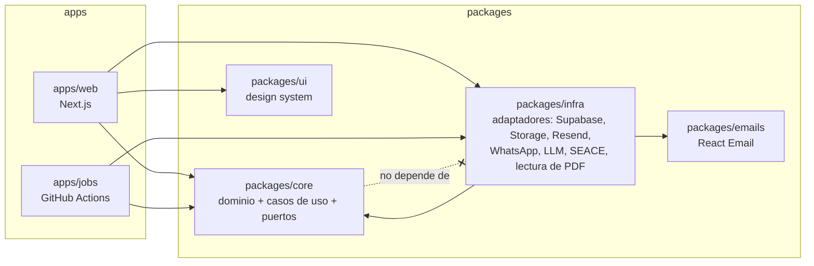
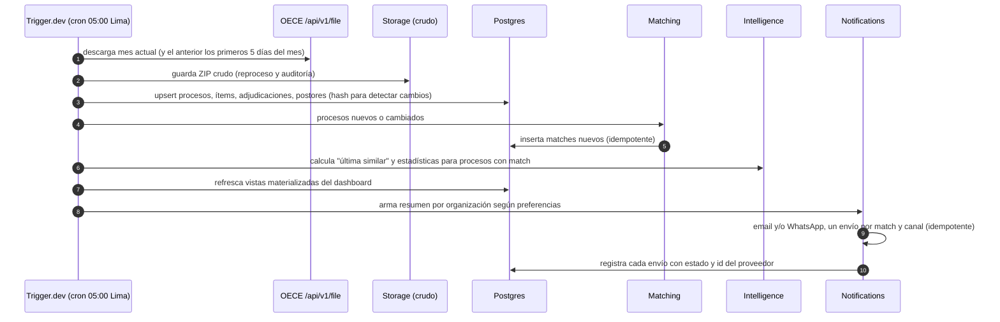
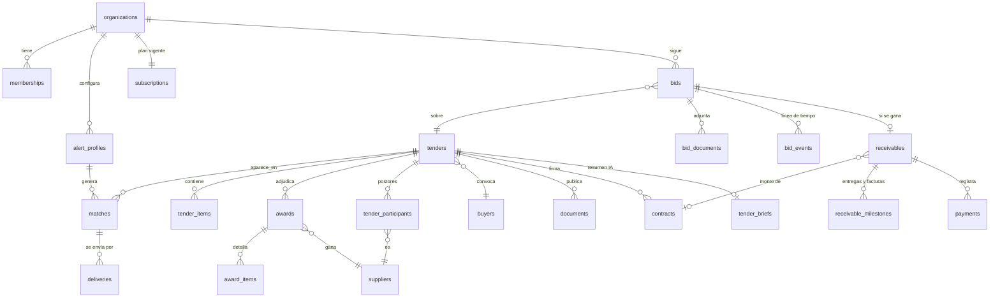

# Arquitectura

> Documento vivo. Cualquier cambio de stack o de límites entre módulos se registra primero como ADR (ver §10) y luego se refleja aquí.

## 1. Contexto y objetivo

Plataforma web B2B (SaaS) para empresas peruanas, sobre todo MYPEs, que venden o quieren vender al Estado. Acompaña **el ciclo de vida completo** de cada licitación, con SEACE como única fuente pública ([ADR 0009](adr/0009-sin-peru-compras.md)):

1. **Alertas inteligentes**: cada día, las oportunidades que encajan con la empresa, ordenadas por relevancia, por email y/o WhatsApp, con **la última contratación similar (ganador, precio, postores)**, resumen de las bases con IA, precio sugerido y recomendaciones (§6.4, §6.6).
2. **Postulaciones y resultados**: a qué entra, con qué precio, sus documentos, una línea de tiempo de lo que pasó, y el resultado (sugerido por RUC a partir de SEACE) (§6.7).
3. **Cobranzas**: seguimiento de lo que cada entidad le debe por los contratos ganados y de los pagos recibidos. Es un registro, no una gestión de cobro (§6.8).
4. **Análisis**: tablero de su propio desempeño y del mercado histórico (§6.9).
5. **Asesor con IA**: retroalimentación basada en su historial, sus postulaciones y el mercado (§6.6).

Las capas 2 a 5 guardan **datos privados y sensibles** de cada empresa (precios ofertados, montos ganados, deudas, documentos). Eso eleva las exigencias de seguridad, respaldo y privacidad (§5.5) y la calidad de la experiencia es un requisito del producto, no un acabado (PRODUCT.md §7.1).

Acceso solo con cuenta. Las cuentas se crean por invitación después de cerrar un trato (modelo _sales-led_), igual que hacen los SaaS B2B de este rubro.

## 2. Lo que ya existe y qué pasa con ello

| Pieza actual                                                                                              | Estado                                                   | Destino en la nueva arquitectura                                                                                                                      |
| --------------------------------------------------------------------------------------------------------- | -------------------------------------------------------- | ----------------------------------------------------------------------------------------------------------------------------------------------------- |
| Endpoint OECE `GET /api/v1/file/seace_v3/json/{año}/{mes}`                                                | Validado, responde 200 sin WAF                           | Se mantiene como fuente principal de SEACE                                                                                                            |
| `src/pipeline/normalize.py` + código JS en nodos n8n                                                      | Funciona, pero descarta adjudicaciones, postores e ítems | Se porta a TypeScript en `packages/infra/sources/seace` y se amplía (ver §6.1)                                                                        |
| Supabase Postgres (`tenders`, `documents`, `mype_profiles`, `tender_matches`, `refresh_tender_matches()`) | En producción con ~144k procesos                         | Se conserva Supabase. El esquema pasa a migraciones versionadas en `supabase/migrations`                                                              |
| n8n: sync diario, onboarding por formulario, notificación WhatsApp                                        | Prototipo validado                                       | Sale del camino crítico. El flujo core pasa a código versionado y testeado (`apps/jobs`). n8n puede quedar para automatizaciones internas no críticas |
| Clasificación de rubro con LLM sobre catálogo de 389 familias UNSPSC                                      | Validada                                                 | Se conserva como caso de uso `SuggestCategories` detrás de un puerto `LlmClassifier`                                                                  |
| Plantilla WhatsApp `licitacion_nueva` (Marketing)                                                         | En revisión en Meta                                      | Se reemplaza por una plantilla de **resumen diario** (ver §6.5)                                                                                       |
| Power BI "publicar en la web"                                                                             | Idea                                                     | **No recomendado** para clientes (ver §5.4). Power BI queda solo para análisis interno                                                                |

### Hallazgo clave en los datos

El OCDS de SEACE trae bastante más de lo que normalizamos hoy. En octubre 2026: 6,671 procesos, **3,625 con adjudicación y proveedor ganador**, 1,276 con contrato, 334 con más de un ítem. Cada ítem adjudicado trae:

- código **CUBSO** de 16 dígitos (producto exacto) además del **UNSPSC** de 8,
- cantidad, unidad y monto adjudicado, de donde sale el **precio unitario**,
- el ganador con RUC (`awards[].suppliers`) y **todos los postores** (`parties[]` con rol `tenderer`).

Esto hace viable el valor agregado de "última similar + ganador + precio" sin fuentes externas. Hoy esos campos se descartan en la normalización: es lo primero que hay que corregir.

## 3. Referentes: cómo lo hacen empresas similares

| Referente                                         | Modelo                                                                                                                                                                              | Qué tomamos                                                                                                                                                                             |
| ------------------------------------------------- | ----------------------------------------------------------------------------------------------------------------------------------------------------------------------------------- | --------------------------------------------------------------------------------------------------------------------------------------------------------------------------------------- |
| **LicitaLAB** (Chile, opera en Perú hace ~2 años) | SaaS por usuario (Capterra lo lista desde ~US$90/usuario), alertas, panel de seguimiento, análisis de precios históricos, competidores y comportamiento del comprador, asistente IA | Es el competidor directo. Confirma que seguimiento + inteligencia de precios es lo que se paga. Nuestro diferencial: WhatsApp primero, foco MYPE regional, precio unitario por producto |
| **GovSpend / Deltek GovWin** (EE.UU.)             | Venta por demo, contrato anual, onboarding con customer success                                                                                                                     | Modelo _sales-led_, cuentas por invitación, perfiles de búsqueda guardados, fichas de competidor y de entidad                                                                           |
| **Tussell** (Reino Unido)                         | Inteligencia de mercado sobre datos OCDS                                                                                                                                            | Fichas por proveedor (qué gana, dónde, a qué precio) y por comprador; datos crudos → modelo analítico                                                                                   |
| SaaS B2B en general (Linear, Notion, HubSpot)     | Organización → miembros → roles; invitación; plan con _entitlements_                                                                                                                | Multi-tenant por organización, roles, límites por plan, backoffice interno                                                                                                              |

Patrón común en todos: **la cuenta es de la empresa (organización), no de la persona**; la facturación B2B va por contrato y factura; el producto se activa con un onboarding guiado que lleva al primer "momento de valor" en minutos (ver una oportunidad real que te sirve).

## 4. Stack recomendado

Criterios: un equipo chico, un solo lenguaje de punta a punta, servicios administrados (sin servidores que mantener), escalable sin rediseño hasta miles de clientes, y reutilizar lo que ya funciona (Supabase).

| Capa                                    | Elección                                                                                                                                                                                                                               | Por qué                                                                                                                                                        | Alternativa descartada                                                                  |
| --------------------------------------- | -------------------------------------------------------------------------------------------------------------------------------------------------------------------------------------------------------------------------------------- | -------------------------------------------------------------------------------------------------------------------------------------------------------------- | --------------------------------------------------------------------------------------- |
| Lenguaje                                | **TypeScript** (strict) en todo el repo                                                                                                                                                                                                | Un lenguaje para web, jobs y dominio; tipos compartidos de punta a punta                                                                                       | Python para ingesta: obliga a duplicar modelos y validaciones                           |
| Monorepo                                | **pnpm workspaces + Turborepo**                                                                                                                                                                                                        | Paquetes compartidos, builds incrementales, CI rápido                                                                                                          | Repos separados: más fricción para un equipo chico                                      |
| Web (landing + app + backoffice)        | **Next.js (App Router, última estable) + React**                                                                                                                                                                                       | SSR/SSG para SEO de la landing y app autenticada en el mismo proyecto; Server Components y Server Actions                                                      | SPA + API aparte: dos despliegues y peor SEO                                            |
| UI                                      | **Tailwind CSS + shadcn/ui (Radix)**, TanStack Table, gráficos de shadcn (Recharts), Server Actions + Zod                                                                                                                              | Componentes accesibles que viven en nuestro repo; tablas y gráficos densos para el BI interno                                                                  | Librerías de UI cerradas (MUI): más difíciles de adaptar                                |
| Base de datos                           | **Supabase Postgres** (región São Paulo, la más cercana)                                                                                                                                                                               | Ya está en uso; Postgres cubre transacciones, búsqueda (`pg_trgm`, full-text en español), vectores (`pgvector`) y analítica con vistas materializadas          | Base aparte para BI: innecesaria al volumen actual (~80k procesos/año)                  |
| Auth                                    | **Supabase Auth** con registro público **desactivado** e invitaciones desde el backoffice; MFA para administradores                                                                                                                    | Integra con RLS; soporta invitación, magic link, Google                                                                                                        | Auth propio: riesgo sin beneficio                                                       |
| Autorización                            | **Row Level Security** por `organization_id` + _entitlements_ por plan                                                                                                                                                                 | El aislamiento entre clientes lo garantiza la base, no el código de la app                                                                                     | Filtros solo en la app: un bug filtra datos de otro cliente                             |
| Archivos                                | **Supabase Storage**: bucket privado `org-files` con carpeta por organización y políticas RLS; bucket interno para bases descargadas de SEACE                                                                                          | Documentos de postulaciones y de cobranzas del cliente; bases de SEACE para el resumen con IA                                                                  | S3 aparte: otra credencial más                                                          |
| Jobs en segundo plano                   | **GitHub Actions** hoy ([ADR 0008](adr/0008-jobs-en-github-actions.md)); **Trigger.dev** cuando el procesamiento de bases con IA lo justifique (cola, reintentos por paso)                                                             | Ingesta y avisos caben en Actions; el resumen de bases es trabajo por documento, con reintentos y límites de proveedor                                         | n8n: no versionable ni testeable                                                        |
| Email                                   | **Resend + React Email**                                                                                                                                                                                                               | Plantillas como componentes React, buena entregabilidad, dominio propio con SPF/DKIM                                                                           | SMTP genérico                                                                           |
| WhatsApp                                | **WhatsApp Cloud API de Meta** directo, detrás de un adaptador                                                                                                                                                                         | Ya está configurado; sin intermediario ni recargo                                                                                                              | BSP (Twilio, etc.): suma costo por mensaje; se puede cambiar luego sin tocar el dominio |
| IA (LLM)                                | **Proveedor intercambiable** detrás de puertos por tarea (§6.6): modelo pequeño para clasificar (`gpt-4o-mini`, ya validado) y uno de contexto largo para leer bases. API con retención cero y sin entrenamiento con datos del cliente | Cada tarea usa el modelo más barato que la resuelve bien; cambiar de proveedor no toca el dominio                                                              | Un solo modelo grande para todo: caro                                                   |
| Hosting web                             | **Vercel** (plan Pro: el plan Hobby no permite uso comercial)                                                                                                                                                                          | Despliegue por push, _preview_ por rama, región São Paulo                                                                                                      | Servidor propio                                                                         |
| Errores                                 | **Sentry**                                                                                                                                                                                                                             | Errores de web y jobs con contexto                                                                                                                             | —                                                                                       |
| Analítica de producto y _feature flags_ | **PostHog**                                                                                                                                                                                                                            | Embudo de onboarding, uso de funciones, flags para lanzar por cliente                                                                                          | —                                                                                       |
| Anti-spam en formularios públicos       | **Cloudflare Turnstile** + rate limit (Upstash Redis)                                                                                                                                                                                  | El formulario de demo será atacado por bots                                                                                                                    | —                                                                                       |
| Facturación                             | **Fuera de la plataforma** al inicio: contrato + transferencia + factura electrónica SUNAT (vía un OSE/PSE como Nubefact). La app solo muestra plan y vigencia                                                                         | Stripe no opera con empresas peruanas y los clientes B2B piden factura SUNAT. Cobro con tarjeta (Culqi o Mercado Pago) solo cuando exista un plan autoservicio | Cobro in-app desde el día 1: complejidad sin demanda                                    |

**Costo fijo estimado al inicio:** Vercel Pro US$20 + Supabase Pro US$25 (el plan gratuito limita la base a 500 MB y ya estamos cerca con el histórico) + Trigger.dev ~US$10 + dominio. Resend, Sentry y PostHog arrancan en su plan gratuito. WhatsApp se paga por mensaje según la tarifa de Meta para Perú (categoría Marketing). **Total ≈ US$60–90/mes** antes de mensajes de WhatsApp.

## 5. Arquitectura

### 5.1 Estilo: monolito modular con puertos y adaptadores

Un solo producto desplegable (la web) más un _worker_ de jobs, organizados por **módulos de negocio** con límites claros. No microservicios: con un equipo chico solo agregan latencia, despliegues y fallas parciales. Si algún módulo crece (por ejemplo ingesta), ya está aislado y se puede extraer.

Dentro de cada módulo se aplica **arquitectura hexagonal**: el dominio y los casos de uso no conocen Next.js, Supabase, Resend ni Meta. Dependen de interfaces (puertos); la infraestructura las implementa (adaptadores).



**Regla de dependencias** (verificada en CI con `dependency-cruiser`):

- `core` no importa nada de `infra`, `apps`, Next.js ni SDKs externos.
- `infra` implementa puertos de `core`.
- `apps` arman las dependencias (composición) y exponen casos de uso por HTTP, Server Actions o tareas programadas.

### 5.2 Módulos de negocio

| Módulo          | Responsabilidad                                                                                       | Entidades principales                                                                               |
| --------------- | ----------------------------------------------------------------------------------------------------- | --------------------------------------------------------------------------------------------------- |
| `accounts`      | Organizaciones, miembros, roles, invitaciones, plan y vigencia                                        | `organizations`, `memberships`, `invitations`, `subscriptions`, `plans`                             |
| `ingestion`     | Traer datos de fuentes, guardar crudo, normalizar, detectar cambios                                   | `ingestion_runs`, archivos crudos en Storage                                                        |
| `procurement`   | Modelo canónico de contrataciones públicas (solo SEACE)                                               | `tenders`, `tender_items`, `awards`, `award_items`, `tender_participants`, `contracts`, `documents` |
| `matching`      | Perfiles de alerta, cruce y orden por relevancia                                                      | `alert_profiles`, `alert_matches`, `match_feedback`                                                 |
| `intelligence`  | Similares, precio sugerido, resumen de bases con IA (datos públicos, se calculan una vez por proceso) | `tender_briefs`, `last_similar_awards()`, vistas `mv_*`                                             |
| `notifications` | Canales, preferencias, consentimiento, envíos y su resultado                                          | `notification_settings`, `deliveries`                                                               |
| `bids`          | Postulaciones del cliente: estado, precio, documentos, línea de tiempo, resultado                     | `bids`, `bid_events`, `bid_documents`                                                               |
| `receivables`   | Cobranzas de contratos ganados: entregas, facturas, pagos, saldo                                      | `receivables`, `receivable_milestones`, `payments`                                                  |
| `analytics`     | Tableros de la empresa y del mercado                                                                  | Vistas `mv_*` del mercado; consultas sobre `bids` y `receivables` para la empresa                   |
| `advisor`       | Retroalimentación con IA sobre los datos privados de la empresa                                       | `advisor_reports`, `ai_usage`                                                                       |
| `backoffice`    | Operación interna: alta de clientes, salud de la ingesta, uso de IA                                   | Usa los anteriores con rol `platform_admin`                                                         |
| `marketing`     | Landing, contenido, leads                                                                             | `leads`                                                                                             |

### 5.3 Flujo de datos diario



Propiedades que este diseño garantiza:

- **Idempotencia**: correr el job dos veces no duplica datos ni mensajes. Upserts por clave natural (`ocid`, `award_id`), `unique (match_id, channel)` en `deliveries`.
- **Reprocesable**: el crudo queda guardado. Si mejoramos la normalización, se reprocesa el histórico sin volver a descargar.
- **Observable**: cada corrida deja un registro en `ingestion_runs` (filas leídas, insertadas, actualizadas, errores, duración) y el panel de Trigger.dev muestra cada paso.
- **No reenvía**: un match notificado no se vuelve a enviar (ver `deliveries`); un proceso **actualizado** que el cliente sigue sí genera un aviso distinto ("cambió el cronograma", "se publicó la buena pro").

### 5.4 Por qué no Power BI "publicar en la web" para clientes

"Publicar en la web" genera un enlace **público, sin login**: cualquiera con el link ve todo, no se puede filtrar por cliente y no se puede cobrar por acceso. La alternativa con login (Power BI Embedded) requiere capacidad dedicada con un costo mensual alto para esta etapa. El dashboard para clientes se construye dentro de la app sobre vistas materializadas de Postgres, con el mismo login, permisos y diseño. Power BI sigue siendo útil para análisis interno conectándose a la misma base con un usuario de solo lectura.

### 5.5 Multi-tenancy y seguridad de datos

- Toda tabla con datos de un cliente tiene `organization_id` y **RLS activado**. Política base: el usuario ve filas de organizaciones donde es miembro (`is_org_member(organization_id)`, función `security definer`).
- Los datos públicos enriquecidos (procesos, adjudicaciones, estadísticas) se leen solo con suscripción vigente (`has_active_subscription()`). Los datos son públicos en origen; lo que vendemos es la curaduría y el cruce.
- La `service_role key` de Supabase solo existe en `apps/jobs` y en código de servidor del backoffice. Nunca en el navegador.
- Roles: `platform_admin` (nuestro equipo), `owner`, `admin`, `member` dentro de cada organización.
- Las políticas RLS se prueban con **pgTAP** en CI (ver ENGINEERING_STANDARDS.md).

Con postulaciones, cobranzas y documentos la plataforma guarda **datos privados y sensibles**. Se suma:

- **Archivos**: bucket privado `org-files`, ruta `{organization_id}/{módulo}/{id}/{archivo}`. Las políticas de `storage.objects` exigen ser miembro de la organización del primer segmento de la ruta. Descarga solo con URL firmada de corta duración; tamaño y tipo de archivo validados al subir.
- **Permiso de finanzas**: cobranzas y pagos solo los ven `owner`, `admin` y los miembros con el permiso `finance`. Las postulaciones (incluido el precio ofertado) las ve todo el equipo, porque todo el equipo las prepara. Se aplica en RLS, no solo en la interfaz.
- **Cuenta vencida = solo lectura**: con la suscripción vencida se puede ver y exportar todo, pero no crear ni modificar (las políticas de escritura exigen `has_active_subscription()`).
- **Auditoría**: cada cambio en postulaciones y cobranzas queda en su línea de tiempo (`bid_events`, eventos de cobranza) con quién y cuándo. Es historial para el cliente y auditoría para nosotros.
- **Respaldo**: Supabase Pro (respaldos diarios con 7 días de retención). Con clientes pagando, sumar el complemento de restauración a un punto en el tiempo. Ya no es opcional cuando hay datos que el cliente no puede volver a generar.
- **IA y privacidad**: a la IA solo se envía lo necesario para cada tarea (agregados antes que filas). Proveedor con retención cero. Los términos y la política de privacidad lo declaran (Ley 29733).
- **Derechos del titular**: exportar todos los datos de una organización y borrarlos al terminar el contrato.

## 6. Diseño de los módulos clave

### 6.1 Modelo de datos (resumen)

Capas de datos, versión liviana del patrón _medallion_:

1. **Crudo**: archivos tal cual llegan, en Storage (`raw/seace/2026/11/2026-11-17.zip`).
2. **Canónico**: tablas normalizadas, una fila por concepto real.
3. **Analítico**: vistas materializadas para dashboard y similares.



Cambios respecto al esquema actual:

- `tender_items`: hoy guardamos un UNSPSC por proceso; el OCDS trae ítems con CUBSO, UNSPSC, cantidad y unidad. El matching y los similares trabajan a nivel ítem.
- `awards`, `award_items`, `suppliers`, `tender_participants`: nuevos. Habilitan ganador, precio unitario, cantidad de postores y fichas de competidor.
- `mype_profiles` se convierte en `alert_profiles` (una organización puede tener varios: por línea de negocio o por región) con palabras clave a incluir o excluir.
- `tender_matches.notified_at` se reemplaza por `deliveries` (un registro por canal, con estado, id del mensaje y error), porque un match puede ir por email y WhatsApp.
- Montos: se guarda moneda original y `amount_pen` (el OCDS ya trae `amount_PEN`). Fechas en `timestamptz`; se muestran en hora de Lima.

### 6.2 Fuentes de datos

| Fuente                             | Qué aporta                                                                 | Acceso                                                                          | Frecuencia            | Riesgos                                                                              |
| ---------------------------------- | -------------------------------------------------------------------------- | ------------------------------------------------------------------------------- | --------------------- | ------------------------------------------------------------------------------------ |
| SEACE (OCDS, OECE)                 | Convocatorias, cronograma, documentos, adjudicaciones, postores, contratos | `GET /api/v1/file/seace_v3/json/{año}/{mes}`                                    | Diario (mes en curso) | Latencia de publicación por medir (ver §8); `/api/v1/releases` está detrás de un WAF |
| Documentos de SEACE (bases, actas) | Texto de las bases para el resumen con IA                                  | URL de cada documento en el OCDS (`prod*.seace.gob.pe`): 49 % PDF, 46 % ZIP/RAR | Al haber match        | Disponibilidad y bloqueo del servidor de documentos; PDF escaneados (ver §6.6)       |
| Catálogos de referencia            | UNSPSC, CUBSO, ubigeo                                                      | Derivados de los mismos datos                                                   | Al ingerir            | —                                                                                    |

Perú Compras (Catálogos Electrónicos y Acuerdos Marco) queda fuera del alcance ([ADR 0009](adr/0009-sin-peru-compras.md)). Si vuelve, entra como otro adaptador del mismo puerto sin tocar el resto.

Lo que SEACE publica y usamos (octubre 2026, 6,671 procesos): ganador con razón social en todas las adjudicaciones, con **RUC en el 70 %** (los consorcios tienen un identificador interno y **no se publican sus integrantes**); **postores con RUC** en 4,228 procesos; contratos firmados en 1,276; fecha de presentación de ofertas en 5,979.

Cada fuente implementa el mismo puerto:

```ts
interface ProcurementSource {
  readonly id: SourceId;
  fetch(period: Period): Promise<RawPayload>;
  parse(raw: RawPayload): AsyncIterable<CanonicalRecord>;
}
```

Agregar una fuente nueva (por ejemplo, el PAC, ver PRODUCT.md) no toca matching, notificaciones ni la web.

### 6.3 Matching

Regla actual (validada): departamento ∩ familia UNSPSC ∩ rango de monto, con monto 0/nulo tratado como "aún sin precio". Evolución:

1. Se evalúa a **nivel ítem** (un proceso con 5 ítems puede encajar por uno solo).
2. Se agregan **palabras clave** a incluir o excluir sobre título y descripción (full-text en español con `unaccent`).
3. Cada match guarda **por qué** encajó (`reasons`: "familia 3011 Concreto", "Arequipa") para mostrarlo al cliente y depurar.
4. El cliente marca "relevante / no relevante"; esa señal se usa para ajustar el perfil.
5. Se implementa como caso de uso en `core` con la consulta en un repositorio de `infra` (una función SQL para el filtrado masivo). La lógica de negocio queda testeable sin base de datos.

### 6.4 "Última contratación similar"

Para cada ítem de un proceso con match se busca la adjudicación más reciente que cumpla, en este orden de fuerza:

| Nivel | Criterio                                                                          | Etiqueta para el cliente |
| ----- | --------------------------------------------------------------------------------- | ------------------------ |
| 1     | Mismo código **CUBSO** (producto exacto)                                          | "Mismo producto"         |
| 2     | Mismo **UNSPSC de 8 dígitos** (commodity)                                         | "Mismo tipo de producto" |
| 3     | Mismo UNSPSC de 6 dígitos (clase) + similitud de texto del ítem ≥ 0.3 (`pg_trgm`) | "Producto similar"       |

Desempates: misma entidad > mismo departamento > más reciente. Ventana: 24 meses.

Datos que se muestran:

- fecha, entidad, ganador (razón social y RUC), monto adjudicado,
- **precio unitario** = monto del ítem adjudicado / cantidad, solo si la unidad coincide,
- número de postores,
- diferencia entre lo adjudicado y el valor referencial (descuento típico),
- y, si hay suficientes datos, la mediana de precio unitario de los últimos 12 meses y los 3 proveedores que más ganan en ese producto y región.

Se calcula en el job diario solo para procesos con match y se guarda en `tender_insights`, así la alerta y la ficha no recalculan nada. Para servicios y obras, donde los códigos son genéricos, la fase 2 agrega similitud semántica con embeddings (`pgvector`).

Estado (noviembre 2026): niveles 1 y 2 implementados en `last_similar_awards()` sobre 12 meses de historia; el nivel 3, los desempates por entidad y región y `tender_insights` quedan para la etapa 2.

Detección de resultados: ver §6.7.

### 6.5 Notificaciones

- Puerto `NotificationChannel` con adaptadores `EmailChannel` (Resend) y `WhatsAppChannel` (Meta). Agregar SMS o Telegram no toca el resto.
- **Resumen diario** por organización a la hora que elija (por defecto 07:00), en vez de un mensaje por licitación: menos costo, menos sensación de spam y más clics.
  - **WhatsApp**: plantilla Marketing con lo esencial ("Hoy tienes 4 oportunidades nuevas. La más relevante: …") y botón con URL dinámica a la app. Los parámetros de plantilla no admiten saltos de línea, por eso el detalle va en la app.
  - **Email**: el detalle completo por oportunidad, incluido el bloque "última similar".
- **Consentimiento**: opt-in explícito de WhatsApp registrado con fecha y fuente (lo exige Meta y la Ley 29733). Baja en un clic en cada canal.
- Cada envío queda en `deliveries` con estado (`queued`, `sent`, `delivered`, `read`, `failed`) actualizado por los webhooks de Resend y Meta.
- El token de WhatsApp de producción es de un **usuario de sistema** de Meta (no vence), guardado como secreto. El token temporal de 24 h solo sirve para pruebas.

### 6.6 Integraciones con IA

Ver [ADR 0010](adr/0010-ia-por-tareas.md). Tres reglas guían todo:

1. **La IA redacta, los números los calcula el sistema.** Precio sugerido, tasa de éxito, saldo por cobrar o diferencia con el ganador salen de SQL y son exactos. La IA solo resume documentos y explica cifras que ya calculamos.
2. **Una tarea, un puerto.** Cada uso de IA es un puerto en `core` con entrada y salida tipadas. Los adaptadores en `infra` piden respuestas en JSON con esquema estricto y las validan con Zod antes de guardarlas. Cambiar de modelo o de proveedor es cambiar un adaptador.
3. **Todo se puede verificar.** Cada dato extraído de las bases lleva su página; la interfaz lo marca como "generado con IA" y enlaza el documento oficial.

| Tarea                             | Puerto (`core`)         | Datos que recibe                                                     | Cuándo corre                                                              | Se guarda en                               |
| --------------------------------- | ----------------------- | -------------------------------------------------------------------- | ------------------------------------------------------------------------- | ------------------------------------------ |
| Sugerir rubros (existe)           | `CategorySuggester`     | Descripción del negocio + catálogo                                   | Al configurar alertas                                                     | El perfil                                  |
| **Resumen de bases**              | `TenderBriefExtractor`  | Texto de las bases (público)                                         | Job, solo para procesos con match; una vez por proceso y versión de bases | `tender_briefs` (compartido)               |
| **Recomendaciones**               | `BidAdvisor`            | Resumen de bases + similares + indicadores de la empresa (agregados) | Al abrir la ficha, con caché por empresa y proceso                        | `bid_advice`                               |
| **Orden por relevancia**          | Embeddings (`pgvector`) | Descripción del proceso y del perfil; feedback "no me sirve"         | Job diario                                                                | Columnas vectoriales + puntaje en el match |
| **Informe mensual**               | `PerformanceReporter`   | Indicadores calculados de sus postulaciones, resultados y cobranzas  | Job mensual                                                               | `advisor_reports`                          |
| Preguntas sobre sus datos (final) | `AdvisorChat`           | Herramientas que consultan su organización con RLS, nunca SQL libre  | A pedido                                                                  | Conversación con vencimiento               |

**Flujo del resumen de bases**: tras el matching, el job encola los procesos nuevos con match → descarga los documentos `biddingDocuments` (y "Bases integradas" cuando reemplazan a las administrativas) → los guarda en Storage → extrae el texto (PDF con texto; ZIP/RAR se descomprimen; los escaneados necesitan OCR) → el modelo de contexto largo devuelve el resumen estructurado con páginas → Zod valida → `tender_briefs`.

**Resultado de la prueba (19 nov 2026)**: los 50 documentos de bases pedidos al servidor de SEACE (`prod1.seace.gob.pe/SeaceWeb-PRO/SdescargarArchivoAlfresco`) respondieron **403 Forbidden**: un firewall bloquea la descarga automática. No se intenta eludirlo. En consecuencia:

1. La ficha y la alerta muestran **los enlaces oficiales** de cada documento; el cliente los abre en su navegador.
2. El resumen con IA se hace **sobre el PDF que el cliente sube** a su postulación (un clic más, solo en procesos que le interesan). El flujo de arriba se mantiene a partir de "extrae el texto".
3. En paralelo se solicita a la OECE acceso formal a los documentos (datos abiertos). Si se obtiene, se activa la descarga automática sin cambiar el resto.

**Control de costo y calidad**: cada llamada se registra en `ai_usage` (organización, tarea, modelo, tokens, costo), con límites mensuales por plan. Un conjunto fijo de bases con respuestas revisadas a mano sirve de prueba de regresión cuando se cambia un prompt o un modelo.

### 6.7 Postulaciones y resultados

- **`bids`**: una por organización y proceso (`unique (organization_id, ocid)`). Estado (`evaluating`, `preparing`, `submitted`, `won`, `lost`, `cancelled`, `withdrawn`), responsable, precio ofertado, monto ganado, motivo si no ganó, origen (`manual`, `alert`, `seace_import`). Las transiciones válidas son reglas de dominio en `core`, con tests.
- **`bid_events`**: línea de tiempo inmutable (cambio de estado, precio, documento, nota, resultado detectado), con autor y fecha. Sirve al cliente como historia y a nosotros como auditoría.
- **`bid_documents`**: metadatos de archivos guardados en `org-files/{org}/bids/{bid}/`.
- **`tender_participants`**: postores de cada proceso con su RUC (datos públicos, se agregan a la ingesta).
- **Resultado sugerido**: cuando SEACE publica la adjudicación de un proceso con postulación `submitted`, el job compara el RUC de la empresa con el ganador y registra un evento "SEACE indica que ganaste" o "SEACE indica que ganó X por S/ Y". **El cliente confirma**: no cambiamos su estado solos. Si postuló en consorcio, no se puede detectar (SEACE no publica los integrantes) y lo registra a mano.
- **Importar historial**: con el RUC de la empresa se buscan en `tender_participants` y `awards` los procesos donde participó y se crean postulaciones `won`/`lost` con origen `seace_import`, en un paso que el cliente revisa antes de confirmar.
- **Recordatorios**: fin de consultas y presentación de ofertas (`tenderPeriod`, que se agrega a la ingesta), por el canal que elija.

### 6.8 Cobranzas

Seguimiento, no gestión de cobro: no hay integración con SUNAT, bancos ni la entidad.

- **`receivables`**: se crea desde una postulación ganada; toma el monto del contrato de SEACE (`contracts`) si existe o lo ingresa el cliente. Incluye adelantos, retención de garantía y penalidades, porque cambian lo que de verdad se cobra.
- **`receivable_milestones`**: entregas o valorizaciones con fecha de conformidad, factura (número, fecha, monto) y fecha esperada de pago, calculada con un plazo configurable.
- **`payments`**: pagos recibidos (fecha, monto, referencia), asociados a una factura o al contrato.
- **Saldo y atraso** se calculan en una vista (`receivable_balances`); los avisos de pago vencido reutilizan las notificaciones.
- Todo bajo el permiso de finanzas (§5.5).

### 6.9 Análisis

- **Mercado**: vistas materializadas agregadas por mes × rubro × departamento × entidad × proveedor, refrescadas por el job diario. Las consultas del tablero leen agregados, nunca las tablas completas. Requiere 2–3 años de historia (Supabase Pro).
- **Mi empresa**: consultas directas sobre `bids`, `receivables` y `payments` (volúmenes chicos por organización), con RLS.
- Gráficos en la propia app (ADR 0006), con el sistema de diseño; cada cifra dice su periodo y fuente.

## 7. Entornos y despliegue

| Entorno    | Web                                      | Base de datos                                                         | Jobs                           | Cuándo               |
| ---------- | ---------------------------------------- | --------------------------------------------------------------------- | ------------------------------ | -------------------- |
| Local      | `pnpm dev`                               | Proyecto Supabase **dev** (gratuito) o `supabase start` si hay Docker | `trigger dev`                  | Desde ya             |
| Preview    | Vercel genera una URL por cada rama o PR | Proyecto Supabase de staging                                          | Entorno staging de Trigger.dev | Cuando haya clientes |
| Producción | Vercel desde `main`                      | Proyecto Supabase de producción                                       | Entorno prod de Trigger.dev    | Desde ya             |

Hoy: se trabaja sobre `main` con CI obligatorio en cada push, y todo cambio se prueba primero en local contra el proyecto dev, nunca contra producción. Las pruebas de RLS (pgTAP) corren en CI con una base Supabase completa en Docker, así que no hace falta Docker en la máquina de desarrollo. Al tener clientes: `main` se protege, todo entra por PR con _preview_, y se agrega el proyecto de staging. El repo ya queda preparado para ese cambio (ver ENGINEERING_STANDARDS.md §8).

Migraciones: se crean con `supabase migration new`, se aplican primero al proyecto dev (`supabase db push` con el proyecto dev enlazado), se versionan en git y luego se aplican a producción. CI valida en cada push que todas las migraciones aplican desde cero y que los tests RLS pasan. Nunca se edita una migración ya aplicada. Cambios que rompen compatibilidad se hacen en dos pasos (_expand/contract_). La puesta en marcha de cada entorno está en el [README](../README.md).

## 8. Riesgos y cómo se mitigan

| Riesgo                                                                                                                                              | Mitigación                                                                                                                                                                  |
| --------------------------------------------------------------------------------------------------------------------------------------------------- | --------------------------------------------------------------------------------------------------------------------------------------------------------------------------- |
| **Latencia de la fuente**: si el archivo mensual se actualiza con días de retraso, una Adjudicación Simplificada puede cerrar antes de que avisemos | Medir desde el día 1 `ingested_at − date_published` por proceso y mostrarlo en el backoffice. Si es alto, investigar fuentes más frescas                                    |
| Cambios de plataforma por la Ley 32069 (OECE, PLADICOP, SEACE 4.0)                                                                                  | Las fuentes están aisladas detrás de `ProcurementSource`; tests con _fixtures_ reales detectan cambios de formato; alerta si una corrida trae 0 filas                       |
| Documentos de SEACE no descargables o escaneados                                                                                                    | Confirmado: SEACE bloquea la descarga automática (403). Enlaces oficiales + resumen sobre el PDF que sube el cliente; pedir acceso formal a la OECE; OCR solo si hace falta |
| La IA inventa o se equivoca en un requisito                                                                                                         | Respuesta con esquema estricto y página citada; etiqueta "generado con IA"; botón para reportar error; conjunto de regresión al cambiar prompts                             |
| Costo de IA descontrolado                                                                                                                           | Resumen una vez por proceso y compartido; solo procesos con match; límites por plan en `ai_usage`                                                                           |
| Fuga o pérdida de datos privados (precios, cobranzas, documentos)                                                                                   | RLS + permiso de finanzas + Storage privado con URL firmada; restauración a un punto en el tiempo; tests pgTAP por tabla                                                    |
| Costo de WhatsApp por mensaje                                                                                                                       | Resumen diario (un mensaje por cliente al día); límite por plan                                                                                                             |
| Fuga de datos entre clientes                                                                                                                        | RLS en todas las tablas de cliente + tests pgTAP en CI                                                                                                                      |
| Clasificación de rubro incorrecta                                                                                                                   | El cliente confirma las categorías sugeridas en el onboarding; feedback "no relevante" en cada alerta                                                                       |

## 9. Estructura del repositorio

```
licitaciones/
├─ apps/
│  ├─ web/                    # Next.js 16
│  │  └─ src/
│  │     ├─ app/
│  │     │  ├─ (marketing)/   # landing y solicitud de demo (público, estático)
│  │     │  ├─ (auth)/        # login, bienvenida (invitación), recuperar y nueva contraseña
│  │     │  ├─ (app)/         # producto: inicio, mi empresa (Fase 1+: oportunidades, alertas...)
│  │     │  ├─ (admin)/admin/ # backoffice interno (rol platform_admin): empresas, leads
│  │     │  └─ auth/          # confirmación de enlaces de correo y cierre de sesión
│  │     ├─ features/<f>/     # por funcionalidad: actions.ts, data.ts, components/, schemas.ts
│  │     ├─ lib/              # sesión (DAL), composición, clientes Supabase, env
│  │     └─ proxy.ts          # refresco de sesión y redirección optimista
│  └─ jobs/                   # sincronización SEACE y avisos WhatsApp (GitHub Actions, ver docs/JOBS.md)
├─ packages/
│  ├─ core/                   # dominio + casos de uso + puertos, sin dependencias de infraestructura
│  │  └─ src/<modulo>/{domain,application,ports.ts,index.ts}
│  ├─ infra/                  # adaptadores: repositorios Supabase, Turnstile (Fase 1: fuentes, canales, LLM)
│  ├─ ui/                     # design system: tokens, botones, campos, tablas, alertas
│  ├─ emails/                 # (Fase 1) plantillas React Email
│  └─ config/                 # tsconfig compartidos (ESLint y Prettier viven en la raíz)
├─ supabase/
│  ├─ migrations/             # esquema versionado (fuente de verdad)
│  ├─ tests/database/         # pgTAP: RLS y funciones SQL
│  └─ templates/              # correos de invitación y recuperación
├─ docs/                      # este documento, estándares, producto, ADRs
├─ .github/                   # CI, Dependabot, plantilla de PR
└─ legacy/                    # prototipo Python y workflows n8n (referencia, fuera del flujo productivo)
```

## 10. Decisiones de arquitectura (ADR)

Cada decisión relevante se registra en [`docs/adr/`](adr/) con la plantilla de ENGINEERING_STANDARDS.md §15. Decisiones iniciales:

| #    | Decisión                                                                | Estado                         |
| ---- | ----------------------------------------------------------------------- | ------------------------------ |
| 0001 | Monolito modular en TypeScript con arquitectura hexagonal               | Aceptada                       |
| 0002 | Supabase (Postgres, Auth, Storage) como plataforma de datos             | Aceptada                       |
| 0003 | Aislamiento multi-tenant con RLS por `organization_id`                  | Aceptada                       |
| 0004 | Jobs en Trigger.dev; n8n fuera del camino crítico                       | Reemplazada por 0008 por ahora |
| 0008 | Jobs en GitHub Actions mientras el volumen sea bajo                     | Aceptada                       |
| 0005 | Cuentas solo por invitación (_sales-led_); cobro fuera de la plataforma | Aceptada                       |
| 0006 | Dashboard de clientes nativo en la app, no Power BI publicado           | Aceptada                       |
| 0007 | Resumen diario como unidad de notificación                              | Aceptada                       |
| 0009 | Sin Perú Compras: SEACE como única fuente                               | Aceptada                       |
| 0010 | IA por tareas: puertos tipados, la IA redacta y el sistema calcula      | Aceptada                       |
