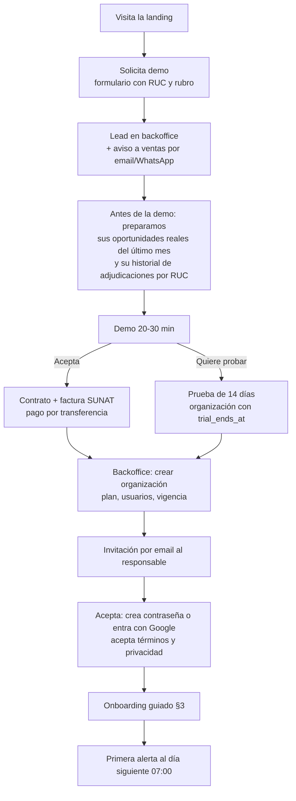
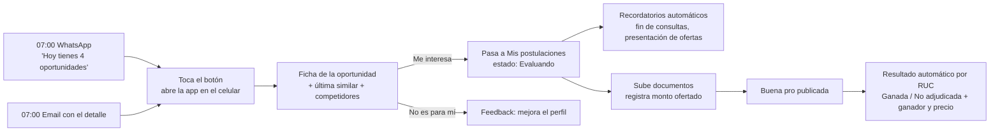

# Producto: flujos, UX/UI y roadmap

Complementa [ARCHITECTURE.md](ARCHITECTURE.md). Aquí está el **qué** y el **para quién**; allá el **cómo**.

## 1. Usuarios

| Persona                                                    | Contexto                                                             | Qué necesita                                                                         |
| ---------------------------------------------------------- | -------------------------------------------------------------------- | ------------------------------------------------------------------------------------ |
| **Dueño/a de MYPE** (ferretería, distribuidora, servicios) | Revisa todo desde el celular, poco tiempo, no conoce UNSPSC ni CUBSO | Saber cada mañana si hay algo que puede ganar y cuánto se pagó la última vez         |
| **Encargado/a de licitaciones** en empresa mediana         | Escritorio, revisa SEACE a diario, arma propuestas                   | Filtrar rápido, seguir varias postulaciones, ver plazos y competencia                |
| **Gerente comercial**                                      | Decide en qué mercados entrar                                        | Ver quién gana qué, dónde y a qué precio                                             |
| **Nuestro equipo** (ventas, customer success, operaciones) | Backoffice                                                           | Dar de alta clientes, revisar perfiles, vigilar que los datos y los envíos funcionen |

## 2. Flujo comercial y de alta (sales-led)

Así lo hacen los SaaS B2B de inteligencia de compras públicas: no hay registro libre; la cuenta se crea después de una demo y un acuerdo.



Decisiones:

- **Pagos fuera de la plataforma** al inicio (contrato, transferencia, factura electrónica). La app muestra plan, vigencia y usuarios disponibles; el backoffice permite extender, pausar o cerrar. Cuando haya un plan autoservicio, se agrega cobro con tarjeta (Culqi o Mercado Pago).
- **Prueba gratuita controlada**: la decide ventas, no es un botón público. Al vencer, la cuenta queda en solo lectura con un aviso para renovar.
- **Demo preparada con datos reales del prospecto**: con su RUC buscamos qué ha ganado antes y qué oportunidades del último mes le habrían llegado. Es el mejor argumento de venta y sale de los mismos datos.

## 3. Onboarding dentro de la app

Objetivo: que en menos de 5 minutos el cliente vea oportunidades reales que le sirven. Es un asistente de 5 pasos, con progreso guardado (puede salir y volver).

| Paso                | Pantalla                                                                                                                                                                                                  | Qué hacemos por detrás                                                                                                                            |
| ------------------- | --------------------------------------------------------------------------------------------------------------------------------------------------------------------------------------------------------- | ------------------------------------------------------------------------------------------------------------------------------------------------- |
| 1. Tu empresa       | RUC → autocompleta razón social, dirección y actividad (consulta RUC). Confirma o corrige                                                                                                                 | Buscamos su **historial en SEACE por RUC**: qué ha ganado, dónde y en qué rubros                                                                  |
| 2. Qué vendes       | Texto libre: "Vendemos cemento, fierro y agregados para construcción". Debajo, **categorías sugeridas** como chips que puede quitar o agregar; si tiene historial, aparecen marcadas "ya has ganado aquí" | El LLM mapea el texto al catálogo; el historial por RUC refuerza la sugerencia. El cliente confirma: ya no hace falta revisión manual obligatoria |
| 3. Dónde atiendes   | Mapa o lista de departamentos, con opción "Todo el Perú"                                                                                                                                                  | —                                                                                                                                                 |
| 4. Montos           | Rango opcional con ejemplos ("hasta S/ 50,000"). Explicación: los procesos sin monto publicado se incluyen igual                                                                                          | —                                                                                                                                                 |
| 5. Cómo te avisamos | Email (ya verificado) y/o WhatsApp: número + **casilla de consentimiento** + mensaje de prueba. Hora del resumen                                                                                          | Guardamos el opt-in con fecha. Enviamos un WhatsApp de bienvenida que, al responderlo, abre la ventana de conversación                            |
| Resultado           | **"Esto te habría llegado en los últimos 30 días"**: lista real de oportunidades con el bloque de última similar. Botón "Ir a mi inicio"                                                                  | Corremos el matching del perfil contra 30 días de histórico                                                                                       |

El estado `pending_review` se mantiene solo como bandera interna para revisar los primeros perfiles de cada cliente durante el piloto, sin bloquear al cliente.

## 4. Operación del día a día

### Cliente



### Equipo interno (backoffice)

| Cada día                                                                | Cada semana                                                    | Cada mes                                |
| ----------------------------------------------------------------------- | -------------------------------------------------------------- | --------------------------------------- |
| Revisar el semáforo de ingesta (corrió, filas, latencia de publicación) | Revisar perfiles con mucho feedback "no relevante"             | Renovaciones de los próximos 30 días    |
| Envíos fallidos (números inválidos, rebotes)                            | Clientes sin actividad en 7 días: contacto de customer success | Métricas de retención y uso por cliente |
| Leads nuevos de la landing                                              | Calidad de "última similar" en una muestra                     | —                                       |

## 5. Mapa del sitio y pantallas

### 5.1 Sitio público (`(marketing)`)

| Página             | Contenido                                                                                                                                                                                                                                                                                                                                                                                                   |
| ------------------ | ----------------------------------------------------------------------------------------------------------------------------------------------------------------------------------------------------------------------------------------------------------------------------------------------------------------------------------------------------------------------------------------------------------- |
| **Inicio**         | Hero con la promesa ("Cada mañana, las licitaciones del Estado que tu empresa puede ganar, con el precio al que se adjudicó la última similar"), ejemplo real de alerta en un celular con WhatsApp, cifras del mercado sacadas de nuestros datos (procesos por mes, montos adjudicados), cómo funciona en 3 pasos, fuentes (SEACE, Perú Compras), para quién es, preguntas frecuentes, CTA "Solicitar demo" |
| **Cómo funciona**  | Detalle de alertas, seguimiento e inteligencia de mercado con capturas                                                                                                                                                                                                                                                                                                                                      |
| **Planes**         | Planes con lo que incluyen y "Solicitar demo" (sin precio público al inicio o con "desde S/ X")                                                                                                                                                                                                                                                                                                             |
| **Recursos**       | Guías: qué es SEACE, qué es Perú Compras y los Catálogos Electrónicos, cómo inscribirse en el RNP, tipos de procedimiento, glosario. Es contenido para SEO y genera leads                                                                                                                                                                                                                                   |
| **Solicitar demo** | Nombre, empresa, RUC, cargo, email, WhatsApp, rubro, "¿ya le vendes al Estado?". Turnstile. Confirmación con próximos pasos                                                                                                                                                                                                                                                                                 |
| **Contacto**       | Formulario breve, WhatsApp de ventas como texto copiable                                                                                                                                                                                                                                                                                                                                                    |
| **Legales**        | Términos, privacidad (Ley 29733), política de cookies                                                                                                                                                                                                                                                                                                                                                       |
| **Ingresar**       | Login                                                                                                                                                                                                                                                                                                                                                                                                       |

### 5.2 Aplicación (`(app)`)

Navegación lateral en escritorio; barra inferior en celular con las 4 primeras.

| Sección                             | Qué muestra                                                                                                                                                                                                                                                                                                             | Acciones                                                                                |
| ----------------------------------- | ----------------------------------------------------------------------------------------------------------------------------------------------------------------------------------------------------------------------------------------------------------------------------------------------------------------------- | --------------------------------------------------------------------------------------- |
| **Inicio**                          | Resumen del día: oportunidades nuevas, plazos que vencen esta semana, postulaciones en curso, últimos resultados                                                                                                                                                                                                        | Ir a cada bloque                                                                        |
| **Oportunidades**                   | Lista de matches con filtros (perfil, departamento, monto, plazo, estado). Cada tarjeta: título, entidad, monto, lugar, "vence en N días", motivo del match, etiqueta de última similar                                                                                                                                 | Seguir, descartar, marcar no relevante, buscar en todo SEACE                            |
| **Ficha de oportunidad**            | Encabezado con estado y plazos (cronograma como línea de tiempo), ítems con cantidades, documentos de SEACE, **panel "Última similar"** (ganador, precio unitario, postores, descuento sobre referencial), mediana de precio 12 meses, top 3 proveedores del producto en la región, historial de compras de esa entidad | Seguir, descargar bases, agregar al calendario, compartir con un compañero              |
| **Mis postulaciones**               | Tablero por estados: Evaluando → Preparando → Presentada → Ganada / No adjudicada / Desistida. Vista tabla alternativa                                                                                                                                                                                                  | Mover de estado, registrar monto ofertado, subir documentos, notas, asignar responsable |
| **Mercado**                         | Dashboard con filtros globales (rubro, región, entidad, periodo, tipo de procedimiento): monto adjudicado, número de procesos, postores promedio, ranking de proveedores ganadores, entidades que más compran, distribución de precio unitario por producto, evolución mensual                                          | Abrir ficha de proveedor o de entidad, exportar CSV (según plan)                        |
| **Ficha de proveedor** (competidor) | Qué gana, dónde, con qué entidades, a qué precios, tasa de éxito                                                                                                                                                                                                                                                        | —                                                                                       |
| **Ficha de entidad**                | Qué compra, cuándo, montos, proveedores habituales                                                                                                                                                                                                                                                                      | —                                                                                       |
| **Alertas**                         | Perfiles de alerta (rubros, regiones, montos, palabras clave), canales, hora del resumen, vista previa                                                                                                                                                                                                                  | Crear, editar, pausar perfiles                                                          |
| **Mi empresa**                      | Datos, usuarios e invitaciones, plan y vigencia, historial de envíos                                                                                                                                                                                                                                                    | Invitar, cambiar roles                                                                  |

### 5.3 Backoffice (`(admin)`)

Organizaciones (alta, plan, vigencia, prueba, pausa), leads, revisión de perfiles, salud de la ingesta y latencia, envíos fallidos, auditoría de acciones.

## 6. Diseño de la alerta

### WhatsApp (plantilla de resumen)

```
Hola {{1}}, hoy encontramos {{2}} oportunidades nuevas para tu empresa.

La más relevante: {{3}}
Entidad: {{4}} · Monto: S/ {{5}} · Vence: {{6}}

[ Ver mis oportunidades ]   <- botón con URL dinámica
```

Corto a propósito: el detalle vive en la app, que se abre en el celular sin volver a iniciar sesión gracias a un enlace firmado de un solo uso y corta duración.

### Email (detalle)

Por cada oportunidad, una tarjeta con: título, entidad, ubicación, monto referencial, plazo, motivo del match y el bloque:

> **Última similar** · Mismo producto · Mar 2026
> Municipalidad Provincial de Arequipa compró 1,200 bolsas de cemento tipo I.
> Ganó **Distribuidora Andina SAC** (RUC 20xxxxxxxxx) a **S/ 27.90 por bolsa**, con 4 postores, 8 % debajo del valor referencial.

Si no hay similar confiable, el bloque no aparece. Nunca se muestra una similar de nivel 3 como si fuera "mismo producto".

## 7. Lineamientos de UX/UI

**Tono**: cercano y directo, en español peruano neutro. Se habla de "rubro", "lo que vendes", "dónde atiendes", "plazo". Nunca "UNSPSC", "OCID", "match" ni "perfil de alerta" en pantallas de cliente (internamente sí).

**Datos**:

- Montos siempre como `S/ 45,000.00`; abreviados en tarjetas (`S/ 45 mil`, `S/ 1.2 M`).
- Plazos relativos y absolutos: "Vence en 3 días · 20 nov".
- Urgencia con forma y color: chip rojo si vence en ≤ 2 días, ámbar ≤ 5.
- Toda cifra del dashboard indica periodo y fuente.

**Sistema visual**:

- Base shadcn/ui personalizada en `packages/ui`: un color de marca, neutros con un leve tono del color de marca, colores semánticos aparte (éxito, alerta, error, información).
- Tipografía: una sans legible para interfaz y números tabulares en tablas y montos.
- Densidad: cómoda en celular, compacta en tablas de escritorio.
- Modo claro y oscuro desde el inicio (tokens CSS).

**Patrones obligatorios**: estado vacío con siguiente paso, _skeletons_ al cargar, confirmación antes de acciones destructivas, mensajes de éxito breves ("Guardado"), errores que dicen cómo resolver.

## 8. Planes (hipótesis para validar en ventas)

|                                | Esencial         | Profesional      | Empresa                |
| ------------------------------ | ---------------- | ---------------- | ---------------------- |
| Perfiles de alerta             | 1                | 5                | Ilimitados             |
| Canales                        | Email + WhatsApp | Email + WhatsApp | Email + WhatsApp       |
| Última similar en alertas      | Sí               | Sí               | Sí                     |
| Mis postulaciones y documentos | —                | Sí               | Sí                     |
| Mercado (dashboard)            | Vista limitada   | Completo         | Completo + exportación |
| Usuarios                       | 1                | 3                | A medida               |

Referencia de mercado: LicitaLAB se lista desde ~US$90 por usuario al mes. Los límites se implementan como _entitlements_ en la base, así cambiar un plan no requiere desplegar código.

## 9. Lo que falta o mejoraría al MVP

Ordenado por impacto sobre retención y venta:

1. **Ingerir adjudicaciones, postores e ítems** (hoy se descartan). Sin esto no existe el valor agregado principal.
2. **Medir la latencia de publicación** de la fuente. Si avisamos tarde, el producto pierde sentido; hay que saberlo desde el día 1.
3. **Historial por RUC en el onboarding**: muestra valor inmediato y mejora el perfil de alertas con datos reales.
4. **Resultado automático por RUC** en Mis postulaciones.
5. **Avisos de cambios** en procesos que el cliente sigue: prórrogas, absolución de consultas, buena pro, nulidad.
6. **Recordatorios de plazos** y exportación al calendario (`.ics`).
7. **Feedback "no relevante"** para afinar perfiles.
8. **Palabras clave** a incluir o excluir en los perfiles.
9. **Contenido educativo** (Recursos) para SEO y para el segmento que aún no vende al Estado.
10. **Cumplimiento legal**: términos, privacidad, registro del banco de datos personales ante la autoridad de protección de datos, consentimiento por canal.

A investigar para fases siguientes:

- **PAC (Plan Anual de Contrataciones)**: anticipar qué van a comprar las entidades antes de que convoquen.
- **Convocatorias de incorporación a Acuerdos Marco** de Perú Compras para el rubro del cliente.
- **Estado del RNP** del cliente (requisito para postular) y aviso de vencimiento.
- **Contrataciones de montos menores** bajo la Ley 32069, si se publican en la PLADICOP: mercado natural para MYPEs.
- **Asistente de bases**: resumen con IA de los requisitos de un proceso a partir de sus documentos.

## 10. Roadmap

| Fase                  | Contenido                                                                                                                                                    | Resultado esperado                                              |
| --------------------- | ------------------------------------------------------------------------------------------------------------------------------------------------------------ | --------------------------------------------------------------- |
| **0. Fundaciones** ✅ | Monorepo, CI, entornos, migraciones del esquema actual, Auth, organizaciones, RLS, backoffice mínimo, landing + demo                                         | Se puede crear una organización e invitar a alguien             |
| **1. Alertas**        | Ingesta ampliada (adjudicaciones, ítems, postores) en Trigger.dev, matching por ítem, última similar, resumen diario por email y WhatsApp, onboarding guiado | Primeros clientes piloto recibiendo valor diario                |
| **2. Seguimiento**    | Mis postulaciones, documentos, recordatorios, resultado automático, avisos de cambios                                                                        | El cliente trabaja dentro de la plataforma, no solo lee alertas |
| **3. Mercado**        | Dashboard, fichas de proveedor y entidad, Perú Compras como fuente de precios                                                                                | Justifica el plan Profesional                                   |
| **4. Escala**         | Staging y PRs obligatorios, cobro con tarjeta para plan autoservicio, PAC, asistente de bases                                                                | Crecimiento sin depender solo de ventas                         |

## 11. Métricas

| Métrica                | Definición                                                              |
| ---------------------- | ----------------------------------------------------------------------- |
| **Estrella del norte** | Oportunidades abiertas (ficha vista) por organización activa por semana |
| Activación             | % de organizaciones que completan el onboarding y ven una ficha en 48 h |
| Relevancia             | % de oportunidades marcadas "no relevante" (debe bajar)                 |
| Frescura               | Mediana de horas entre publicación en SEACE y nuestro aviso             |
| Entrega                | % de envíos entregados por canal                                        |
| Retención              | Organizaciones activas que renuevan                                     |
