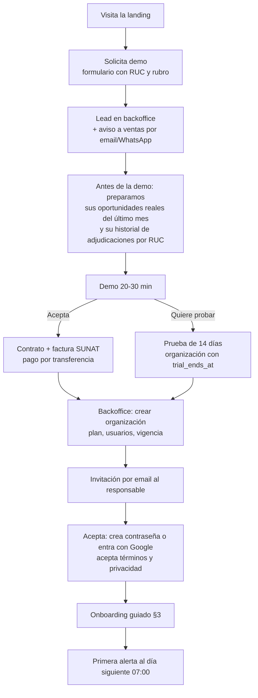
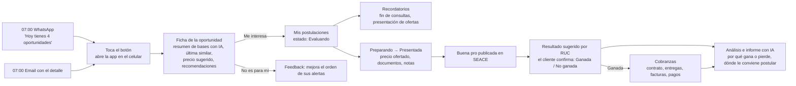

# Producto: flujos, UX/UI y roadmap

Complementa [ARCHITECTURE.md](ARCHITECTURE.md). Aquí está el **qué** y el **para quién**; allá el **cómo**.

**Alcance.** No es solo un servicio de alertas: es el lugar donde la empresa gestiona **todo el ciclo de vida** de sus licitaciones con el Estado, con SEACE como única fuente pública (Perú Compras queda fuera, ver [ADR 0009](adr/0009-sin-peru-compras.md)):

1. **Descubrir**: alertas a su medida, ordenadas por relevancia, con resumen de requisitos de las bases, enlaces oficiales, la última contratación similar y su precio, y recomendaciones para abordarla.
2. **Postular**: seguimiento de cada postulación, precio ofertado, documentos propios e historial de lo que pasó.
3. **Resultado**: ganada o no, con el monto; detectado en SEACE cuando es posible.
4. **Cobrar**: seguimiento (no gestión activa) de lo que cada entidad le debe por los contratos ganados y de los pagos recibidos.
5. **Mejorar**: análisis de su desempeño y del mercado, y retroalimentación con IA basada en su propio historial.

La **experiencia de uso es parte del producto**, no un acabado: el competidor directo tiene una interfaz difícil y anticuada, y la diferencia se tiene que notar en el primer minuto (ver §7).

## 1. Usuarios

| Persona                                                    | Contexto                                                             | Qué necesita                                                                         |
| ---------------------------------------------------------- | -------------------------------------------------------------------- | ------------------------------------------------------------------------------------ |
| **Dueño/a de MYPE** (ferretería, distribuidora, servicios) | Revisa todo desde el celular, poco tiempo, no conoce UNSPSC ni CUBSO | Saber cada mañana si hay algo que puede ganar y cuánto se pagó la última vez         |
| **Encargado/a de licitaciones** en empresa mediana         | Escritorio, revisa SEACE a diario, arma propuestas                   | Filtrar rápido, seguir varias postulaciones, ver plazos y competencia                |
| **Gerente comercial**                                      | Decide en qué mercados entrar                                        | Ver quién gana qué, dónde y a qué precio                                             |
| **Nuestro equipo** (ventas, customer success, operaciones) | Backoffice                                                           | Dar de alta clientes, revisar perfiles, vigilar que los datos y los envíos funcionen |

## 2. Flujo comercial y de alta (sales-led)

Así lo hacen los SaaS B2B de inteligencia de compras públicas: no hay registro libre; la cuenta se crea después de una demo y un acuerdo.



Decisiones:

- **Pagos fuera de la plataforma** al inicio (contrato, transferencia, factura electrónica). La app muestra plan, vigencia y usuarios disponibles; el backoffice permite extender, pausar o cerrar. Cuando haya un plan autoservicio, se agrega cobro con tarjeta (Culqi o Mercado Pago).
- **Prueba gratuita controlada**: la decide ventas, no es un botón público. Al vencer, la cuenta queda en solo lectura con un aviso para renovar.
- **Demo preparada con datos reales del prospecto**: con su RUC buscamos qué ha ganado antes y qué oportunidades del último mes le habrían llegado. Es el mejor argumento de venta y sale de los mismos datos.

## 3. Onboarding dentro de la app

Objetivo: que en menos de 5 minutos el cliente vea oportunidades reales que le sirven. Es un asistente de 5 pasos, con progreso guardado (puede salir y volver).

| Paso                | Pantalla                                                                                                                                                                                                  | Qué hacemos por detrás                                                                                                                            |
| ------------------- | --------------------------------------------------------------------------------------------------------------------------------------------------------------------------------------------------------- | ------------------------------------------------------------------------------------------------------------------------------------------------- |
| 1. Tu empresa       | RUC → autocompleta razón social, dirección y actividad (consulta RUC). Confirma o corrige                                                                                                                 | Buscamos su **historial en SEACE por RUC**: qué ha ganado, dónde y en qué rubros                                                                  |
| 2. Qué vendes       | Texto libre: "Vendemos cemento, fierro y agregados para construcción". Debajo, **categorías sugeridas** como chips que puede quitar o agregar; si tiene historial, aparecen marcadas "ya has ganado aquí" | El LLM mapea el texto al catálogo; el historial por RUC refuerza la sugerencia. El cliente confirma: ya no hace falta revisión manual obligatoria |
| 3. Dónde atiendes   | Mapa o lista de departamentos, con opción "Todo el Perú"                                                                                                                                                  | —                                                                                                                                                 |
| 4. Montos           | Rango opcional con ejemplos ("hasta S/ 50,000"). Explicación: los procesos sin monto publicado se incluyen igual                                                                                          | —                                                                                                                                                 |
| 5. Cómo te avisamos | Email (ya verificado) y/o WhatsApp: número + **casilla de consentimiento** + mensaje de prueba. Hora del resumen                                                                                          | Guardamos el opt-in con fecha. Enviamos un WhatsApp de bienvenida que, al responderlo, abre la ventana de conversación                            |
| Resultado           | **"Esto te habría llegado en los últimos 30 días"**: lista real de oportunidades con el bloque de última similar. Botón "Ir a mi inicio"                                                                  | Corremos el matching del perfil contra 30 días de histórico                                                                                       |

El estado `pending_review` se mantiene solo como bandera interna para revisar los primeros perfiles de cada cliente durante el piloto, sin bloquear al cliente.

## 4. Operación del día a día

### Cliente



### Equipo interno (backoffice)

| Cada día                                                                | Cada semana                                                    | Cada mes                                |
| ----------------------------------------------------------------------- | -------------------------------------------------------------- | --------------------------------------- |
| Revisar el semáforo de ingesta (corrió, filas, latencia de publicación) | Revisar perfiles con mucho feedback "no relevante"             | Renovaciones de los próximos 30 días    |
| Envíos fallidos (números inválidos, rebotes)                            | Clientes sin actividad en 7 días: contacto de customer success | Métricas de retención y uso por cliente |
| Leads nuevos de la landing                                              | Calidad de "última similar" en una muestra                     | —                                       |

## 5. Mapa del sitio y pantallas

### 5.1 Sitio público (`(marketing)`)

| Página             | Contenido                                                                                                                                                                                                                                                                                                                                                                                                                                                      |
| ------------------ | -------------------------------------------------------------------------------------------------------------------------------------------------------------------------------------------------------------------------------------------------------------------------------------------------------------------------------------------------------------------------------------------------------------------------------------------------------------- |
| **Inicio**         | Hero con la promesa ("Cada mañana, las licitaciones del Estado que tu empresa puede ganar, con el precio al que se adjudicó la última similar"), ejemplo real de alerta en un celular con WhatsApp, cifras del mercado sacadas de nuestros datos (procesos por mes, montos adjudicados), cómo funciona (descubrir, postular, cobrar, mejorar), fuente oficial (SEACE), capturas reales del producto, para quién es, preguntas frecuentes, CTA "Solicitar demo" |
| **Cómo funciona**  | Detalle de alertas, postulaciones, cobranzas, análisis e IA, con capturas                                                                                                                                                                                                                                                                                                                                                                                      |
| **Planes**         | Planes con lo que incluyen y "Solicitar demo" (sin precio público al inicio o con "desde S/ X")                                                                                                                                                                                                                                                                                                                                                                |
| **Recursos**       | Guías: qué es SEACE, cómo inscribirse en el RNP, tipos de procedimiento, glosario. Es contenido para SEO y genera leads                                                                                                                                                                                                                                                                                                                                        |
| **Solicitar demo** | Nombre, empresa, RUC, cargo, email, WhatsApp, rubro, "¿ya le vendes al Estado?". Turnstile. Confirmación con próximos pasos                                                                                                                                                                                                                                                                                                                                    |
| **Contacto**       | Formulario breve, WhatsApp de ventas como texto copiable                                                                                                                                                                                                                                                                                                                                                                                                       |
| **Legales**        | Términos, privacidad (Ley 29733), política de cookies                                                                                                                                                                                                                                                                                                                                                                                                          |
| **Ingresar**       | Login                                                                                                                                                                                                                                                                                                                                                                                                                                                          |

### 5.2 Aplicación (`(app)`)

Navegación lateral en escritorio; barra inferior en celular con las 4 primeras.

| Sección                             | Qué muestra                                                                                                                                                                                                                                                                                                                                                                                                                                                                                                                                                                  | Acciones                                                                                                                                    |
| ----------------------------------- | ---------------------------------------------------------------------------------------------------------------------------------------------------------------------------------------------------------------------------------------------------------------------------------------------------------------------------------------------------------------------------------------------------------------------------------------------------------------------------------------------------------------------------------------------------------------------------- | ------------------------------------------------------------------------------------------------------------------------------------------- |
| **Inicio**                          | Resumen del día: oportunidades nuevas, plazos que vencen esta semana, postulaciones en curso, resultados por confirmar, cobros vencidos                                                                                                                                                                                                                                                                                                                                                                                                                                      | Ir a cada bloque                                                                                                                            |
| **Oportunidades**                   | Lista ordenada por relevancia con filtros (perfil, departamento, monto, plazo, estado). Cada tarjeta: descripción, entidad, monto, lugar, "vence en N días", motivo del match, etiqueta de última similar                                                                                                                                                                                                                                                                                                                                                                    | Seguir, descartar, marcar no relevante, buscar en todo SEACE                                                                                |
| **Ficha de oportunidad**            | Encabezado con plazos (cronograma como línea de tiempo), **enlaces oficiales** (documentos de SEACE), **resumen de las bases con IA** (requisitos de calificación, experiencia mínima, plazos, garantías, penalidades, documentos obligatorios; cada dato con su página), **última similar** (ganador, precio unitario, postores, descuento sobre referencial), **precio sugerido** (rango calculado con las adjudicaciones), **recomendaciones** (qué revisar, qué requisito podría faltarle según su historial), ítems con cantidades, historial de compras de esa entidad | Seguir, descargar bases, agregar al calendario, compartir con un compañero                                                                  |
| **Mis postulaciones**               | Tablero por estados: Evaluando → Preparando → Presentada → Ganada / No ganada / Desierta o cancelada / No me presenté. Vista tabla alternativa. Cada postulación tiene su ficha con precio ofertado, responsable, documentos propios, notas y una línea de tiempo con todo lo que pasó                                                                                                                                                                                                                                                                                       | Mover de estado, registrar monto ofertado y resultado, subir documentos, notas, asignar responsable, importar su historial de SEACE por RUC |
| **Cobranzas**                       | Por cada contrato ganado: monto del contrato, adelantos, retenciones y penalidades, entregas o valorizaciones con su conformidad y factura, pagos recibidos, **saldo por cobrar** y días de atraso. Resumen: cuánto le debe cada entidad hoy y antigüedad de la deuda                                                                                                                                                                                                                                                                                                        | Registrar entregas, facturas y pagos; marcar como cobrado. Es un seguimiento: no se contacta a la entidad                                   |
| **Análisis**                        | Dos tableros. **Mi empresa**: postulaciones por estado, tasa de éxito por rubro, región y entidad, monto ganado, precio ofertado frente al ganador, por cobrar. **Mercado**: histórico de SEACE con filtros (rubro, región, entidad, periodo, tipo de procedimiento): monto adjudicado, procesos, postores promedio, ranking de ganadores, entidades que más compran, precio unitario por producto, evolución mensual                                                                                                                                                        | Abrir ficha de proveedor o de entidad, exportar CSV (según plan)                                                                            |
| **Asesor**                          | Informe mensual con IA sobre su desempeño ("pierdes en Arequipa por precio: ofertas 8 % sobre el ganador"), basado en sus postulaciones, resultados y el mercado. Más adelante, preguntas en lenguaje natural sobre sus propios datos                                                                                                                                                                                                                                                                                                                                        | Ver informe, preguntar (fase final)                                                                                                         |
| **Ficha de proveedor** (competidor) | Qué gana, dónde, con qué entidades, a qué precios, tasa de éxito                                                                                                                                                                                                                                                                                                                                                                                                                                                                                                             | —                                                                                                                                           |
| **Ficha de entidad**                | Qué compra, cuándo, montos, proveedores habituales                                                                                                                                                                                                                                                                                                                                                                                                                                                                                                                           | —                                                                                                                                           |
| **Alertas**                         | Perfiles de alerta (rubros, regiones, montos, palabras clave), canales, hora del resumen, vista previa                                                                                                                                                                                                                                                                                                                                                                                                                                                                       | Crear, editar, pausar perfiles                                                                                                              |
| **Mi empresa**                      | Datos, usuarios e invitaciones, plan y vigencia, historial de envíos                                                                                                                                                                                                                                                                                                                                                                                                                                                                                                         | Invitar, cambiar roles                                                                                                                      |

### 5.3 Backoffice (`(admin)`)

Organizaciones (alta, plan, vigencia, prueba, pausa), leads, revisión de perfiles, salud de la ingesta y latencia, envíos fallidos, auditoría de acciones.

## 6. Diseño de la alerta

### WhatsApp (plantilla de resumen)

```
Hola {{1}}, hoy encontramos {{2}} oportunidades nuevas para tu empresa.

La más relevante: {{3}}
Entidad: {{4}} · Monto: S/ {{5}} · Vence: {{6}}

[ Ver mis oportunidades ]   <- botón con URL dinámica
```

Corto a propósito: el detalle vive en la app, que se abre en el celular sin volver a iniciar sesión gracias a un enlace firmado de un solo uso y corta duración.

### Email (detalle)

Por cada oportunidad, una tarjeta con: título, entidad, ubicación, monto referencial, plazo, motivo del match y el bloque:

> **Última similar** · Mismo producto · Mar 2026
> Municipalidad Provincial de Arequipa compró 1,200 bolsas de cemento tipo I.
> Ganó **Distribuidora Andina SAC** (RUC 20xxxxxxxxx) a **S/ 27.90 por bolsa**, con 4 postores, 8 % debajo del valor referencial.

Si no hay similar confiable, el bloque no aparece. Nunca se muestra una similar de nivel 3 como si fuera "mismo producto".

## 7. Lineamientos de UX/UI

### 7.1 Estándar de calidad

La experiencia es el principal diferencial frente al competidor, así que se trata como requisito, con criterios que se verifican antes de dar una pantalla por terminada:

| Criterio                 | Qué significa                                                                                                                                                                                                                                                                                                                                                                     |
| ------------------------ | --------------------------------------------------------------------------------------------------------------------------------------------------------------------------------------------------------------------------------------------------------------------------------------------------------------------------------------------------------------------------------- |
| **Flujo continuo**       | La plataforma sigue el orden real del trabajo: oportunidad → postulación → resultado → cobranza. Cada pantalla lleva a la siguiente etapa sin buscarla (de la ficha se sigue la licitación; del resultado ganado se pasa a la cobranza) y lo que requiere atención hoy aparece primero en Inicio. Nunca se escribe dos veces un dato que ya tenemos (SEACE completa lo que puede) |
| **Obvio**                | Cada pantalla tiene una acción principal clara y el siguiente paso siempre visible. Alguien que nunca vio la app completa las tareas clave sin ayuda                                                                                                                                                                                                                              |
| **Rápido**               | En celular con 4G (percentil 75): carga visible en menos de 2,5 s (LCP), respuesta a un clic en menos de 200 ms (INP), sin saltos de diseño (CLS < 0,1). Las acciones frecuentes responden al instante (interfaz optimista)                                                                                                                                                       |
| **Pocos pasos**          | Seguir una oportunidad, cambiar el estado de una postulación o registrar un pago: un clic o un formulario corto, nunca una página nueva solo para eso                                                                                                                                                                                                                             |
| **Accesible**            | WCAG 2.2 AA: contraste, foco visible, uso completo con teclado, lectores de pantalla, áreas táctiles de 44 px                                                                                                                                                                                                                                                                     |
| **Coherente**            | Todo sale del sistema de diseño (`packages/ui`): mismos componentes, espacios, tipografía y textos para lo mismo. Nada de estilos sueltos por pantalla                                                                                                                                                                                                                            |
| **Celular y escritorio** | Ficha, alertas y registro de pagos se diseñan primero para celular (el cliente llega desde WhatsApp). Tablero de postulaciones, cobranzas y análisis, primero para escritorio, y usables en celular                                                                                                                                                                               |
| **Completo**             | Cada pantalla tiene sus estados vacío, cargando, error y sin permiso, en modo claro y oscuro, revisada a 375 px y a 1280 px                                                                                                                                                                                                                                                       |
| **Comprobado**           | En cada etapa, prueba con 3–5 clientes piloto: 5 tareas reales, medir tiempo y tropiezos, y corregir antes de la siguiente etapa                                                                                                                                                                                                                                                  |

### 7.2 Tono y datos

**Tono**: cercano y directo, en español peruano neutro. Se habla de "rubro", "lo que vendes", "dónde atiendes", "plazo". Nunca "UNSPSC", "OCID", "match" ni "perfil de alerta" en pantallas de cliente (internamente sí).

**Datos**:

- Montos siempre como `S/ 45,000.00`; abreviados en tarjetas (`S/ 45 mil`, `S/ 1.2 M`).
- Plazos relativos y absolutos: "Vence en 3 días · 20 nov".
- Urgencia con forma y color: chip rojo si vence en ≤ 2 días, ámbar ≤ 5.
- Toda cifra del dashboard indica periodo y fuente.

**IA**: todo texto generado con IA se marca como tal, cita la fuente (página de las bases, adjudicación) y nunca reemplaza al documento oficial: "Resumen generado con IA. Verifica en las bases".

### 7.3 Sistema visual

- Base shadcn/ui personalizada en `packages/ui`: un color de marca, neutros con un leve tono del color de marca, colores semánticos aparte (éxito, alerta, error, información).
- Tipografía: una sans legible para interfaz y números tabulares en tablas y montos.
- Densidad: cómoda en celular, compacta en tablas de escritorio.
- Modo claro y oscuro desde el inicio (tokens CSS).

**Patrones obligatorios**: estado vacío con siguiente paso, _skeletons_ al cargar, confirmación antes de acciones destructivas, mensajes de éxito breves ("Guardado"), errores que dicen cómo resolver.

## 8. Planes (hipótesis para validar en ventas)

|                                | Esencial         | Profesional      | Empresa                |
| ------------------------------ | ---------------- | ---------------- | ---------------------- |
| Perfiles de alerta             | 1                | 5                | Ilimitados             |
| Canales                        | Email + WhatsApp | Email + WhatsApp | Email + WhatsApp       |
| Última similar en alertas      | Sí               | Sí               | Sí                     |
| Resumen de bases con IA        | 10 al mes        | 100 al mes       | Ilimitado (uso justo)  |
| Mis postulaciones y documentos | Solo seguimiento | Sí               | Sí                     |
| Cobranzas                      | —                | Sí               | Sí                     |
| Análisis: mi empresa           | Básico           | Completo         | Completo               |
| Análisis: mercado              | Vista limitada   | Completo         | Completo + exportación |
| Asesor con IA                  | —                | Informe mensual  | Informe + preguntas    |
| Usuarios                       | 1                | 3                | A medida               |

Referencia de mercado: LicitaLAB se lista desde ~US$90 por usuario al mes. Los límites se implementan como _entitlements_ en la base, así cambiar un plan no requiere desplegar código.

## 9. Lo que falta o mejoraría al MVP

Ordenado por impacto sobre retención y venta:

1. ~~Ingerir adjudicaciones e ítems~~ (hecho, noviembre 2026). Falta guardar **todos los postores** con su RUC (`tender_participants`), base del historial y del resultado automático.
2. **Medir la latencia de publicación** de la fuente. Si avisamos tarde, el producto pierde sentido; hay que saberlo desde el día 1.
3. **Historial por RUC en el onboarding**: muestra valor inmediato y mejora el perfil de alertas con datos reales.
4. **Resultado automático por RUC** en Mis postulaciones.
5. **Avisos de cambios** en procesos que el cliente sigue: prórrogas, absolución de consultas, buena pro, nulidad.
6. **Recordatorios de plazos** y exportación al calendario (`.ics`).
7. **Feedback "no relevante"** para afinar perfiles.
8. **Palabras clave** a incluir o excluir en los perfiles.
9. **Contenido educativo** (Recursos) para SEO y para el segmento que aún no vende al Estado.
10. **Cumplimiento legal**: términos, privacidad, registro del banco de datos personales ante la autoridad de protección de datos, consentimiento por canal.

A investigar para fases siguientes:

- **PAC (Plan Anual de Contrataciones)**: anticipar qué van a comprar las entidades antes de que convoquen.
- **Estado del RNP** del cliente (requisito para postular) y aviso de vencimiento.
- **Contrataciones de montos menores** bajo la Ley 32069, si se publican en la PLADICOP: mercado natural para MYPEs.

## 10. Roadmap

| Etapa                             | Contenido                                                                                                                                                                                                                   | Resultado esperado                                                        |
| --------------------------------- | --------------------------------------------------------------------------------------------------------------------------------------------------------------------------------------------------------------------------- | ------------------------------------------------------------------------- |
| **0. Fundaciones** ✅             | Monorepo, CI, Auth, organizaciones, RLS, backoffice, landing + demo, alertas con IA, ingesta de SEACE con adjudicaciones, última similar, ficha de oportunidad                                                              | Se puede crear una empresa, configurar alertas y ver oportunidades reales |
| **0.5 Puesta en marcha**          | Despliegue en Vercel con dominio, Supabase Pro, n8n apagado, plantilla final de WhatsApp                                                                                                                                    | Primeros clientes piloto recibiendo alertas                               |
| **1. Postulaciones y resultados** | Mis postulaciones (estados, precio ofertado, documentos, notas, línea de tiempo), resultado manual y sugerido por RUC, importar historial de SEACE, recordatorios de plazos                                                 | El cliente trabaja dentro de la plataforma, no solo lee alertas           |
| **2. Ficha inteligente**          | Enlaces directos a bases y documentos → precio sugerido → resumen de bases con IA sobre el PDF que el cliente sube (SEACE bloquea la descarga automática, ver ARCHITECTURE.md §6.6) → recomendaciones → alerta con todo eso | Cada oportunidad se evalúa en minutos, no en horas                        |
| **3. Cobranzas**                  | Contratos ganados, entregas, facturas, pagos, saldo y atrasos, avisos de pagos vencidos                                                                                                                                     | Sabe cuánto le deben y quién                                              |
| **4. Análisis**                   | Tablero "mi empresa", tablero de mercado, fichas de proveedor y de entidad                                                                                                                                                  | Justifica el plan Profesional                                             |
| **5. Asesor con IA**              | Indicadores → informe mensual → preguntas sobre sus propios datos                                                                                                                                                           | Recomendaciones basadas en su historia real                               |
| **6. Escala**                     | Staging y PRs obligatorios, cobro con tarjeta para plan autoservicio, PAC                                                                                                                                                   | Crecimiento sin depender solo de ventas                                   |

## 11. Métricas

| Métrica                | Definición                                                                                               |
| ---------------------- | -------------------------------------------------------------------------------------------------------- |
| **Estrella del norte** | Oportunidades abiertas (ficha vista) por organización activa por semana                                  |
| Activación             | % de organizaciones que completan el onboarding y ven una ficha en 48 h                                  |
| Relevancia             | % de oportunidades marcadas "no relevante" (debe bajar)                                                  |
| Frescura               | Mediana de horas entre publicación en SEACE y nuestro aviso                                              |
| Entrega                | % de envíos entregados por canal                                                                         |
| Retención              | Organizaciones activas que renuevan                                                                      |
| Adopción del ciclo     | % de organizaciones con al menos una postulación registrada en el mes                                    |
| Calidad de la IA       | % de resúmenes de bases marcados "útil"; errores reportados por resumen                                  |
| Experiencia            | Tiempo para completar las tareas clave en pruebas con pilotos; Web Vitals reales (LCP, INP) por pantalla |
